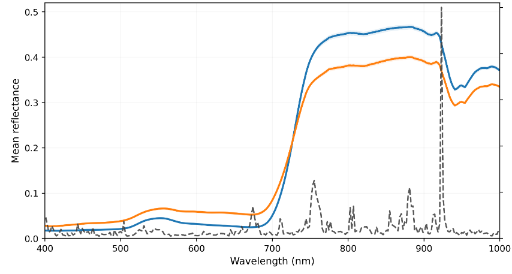
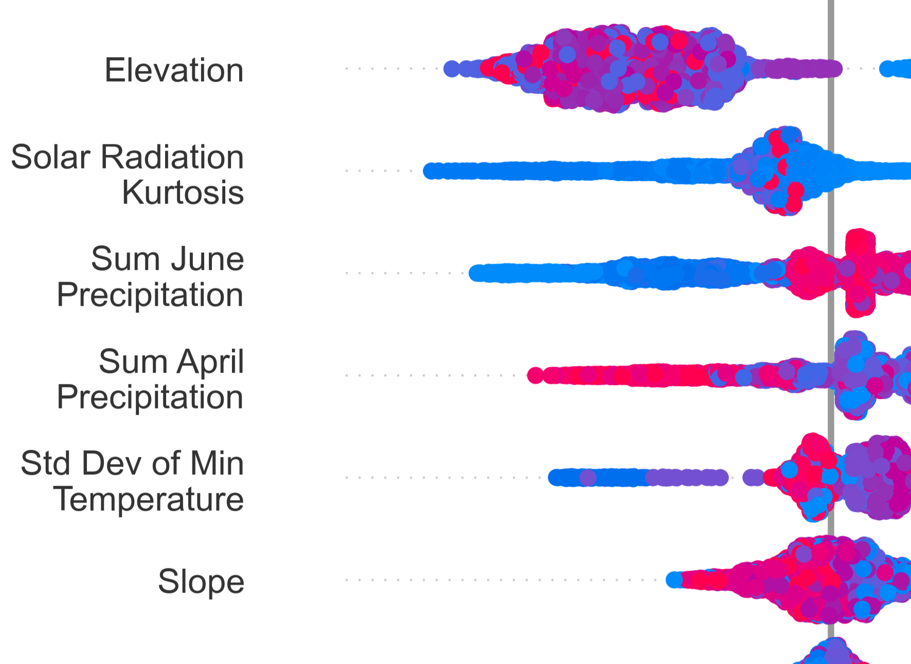
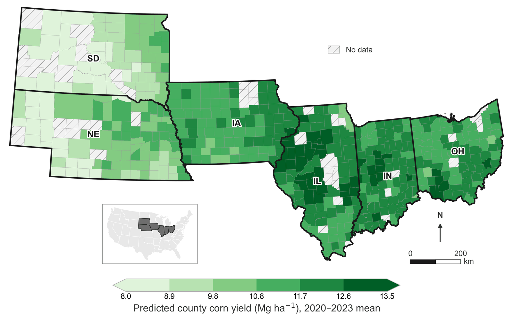

::: {.lede}
We can measure more, model faster, and predict better than ever before. But AI
and remote sensing models are often accurate only where they were trained, and
fragile when applied to new sites, new years, or new organisms. The throughline
of my research is that a model can be highly accurate within the data it was
trained on while its value for decision-making depends on how well it explains
and transfers. I work on making sensor-based measurements of plants, soils, and
water transferable, explainable, and usable, across managed and unmanaged
systems from breeding trials and constructed watersheds to reclaimed mine land
and Ozark forests. Across all three lines of work below I emphasize
interpretable machine learning, rigorous spatial validation, uncertainty
quantification, and open science.
:::

## Seeing what sampling can't

::: {.thrust}
{.lightbox fig-alt="Landsat EVI2 observations across a growing season with a fitted double-logistic curve, marking start of season, peak, and end of season against cumulative growing degree days."}

::: {}
[UAV hyperspectral · Satellite time series · Ground penetrating radar · Trait retrieval · Out-of-distribution validation]{.thrust-meta}

Many of the properties that govern how a system functions are invisible to conventional sampling, or too costly to measure at the scale decisions get made. However, modern sensors help close that gap, but only if the measurement survives outside the conditions it was built in. Working across satellite, UAV, and proximal platforms, I develop trait models and test them where it counts, on held-out sites, years, and genotypes rather than random splits. In soybean, I found that irrigation regime is detectible in the canopy spectrum itself, separable from reflectance alone at over 95% accuracy. Ground-penetrating radar predicted soil coarse fragment content at an R² of 0.81 without a single excavation. The test of a measurement is not how well it fits, but whether it still works somewhere it was never calibrated.

[Selected work: [subsurface soil characterization with ground penetrating radar in a silvopastoral system](https://doi.org/10.32389/JEEG22-001) · [delineating field variation in an agroforestry system](https://doi.org/10.3390/rs14225777)]{.thrust-work}

:::
:::

## Finding the thresholds that matter

::: {.thrust}
{.lightbox fig-alt="SHAP waterfall plot showing how individual features including precipitation variability, sand content, and elevation push a single yield prediction above or below the model's expected value."}

::: {}
[SHAP · Explainable AI · Boundary line analysis · Limiting factors · Spatial cross-validation]{.thrust-meta}

Ecological systems rarely respond to their drivers in easily understood ways. Production is governed by whatever factor is most limiting, and responses often shift abruptly once a threshold is crossed. I use interpretability methods to recover those limiting factors and critical values from models that would otherwise stay opaque: SHAP to expose non-linear responses and tipping points, and boundary line analysis, an empirical expression of Liebig's law of the minimum, to estimate where a response saturates. In U.S. maize, yield falls sharply once maximum temperatures exceed roughly 36 to 38°C. Across 644 Guatemalan farms, the same approach produced soil nutrient targets that Catholic Relief Services adopted for its fertility recommendations.

[Selected work: [environmental drivers of U.S. maize and soybean yield](https://doi.org/10.1038/s41598-026-38724-z) · [critical soil values for major crops in Guatemala](https://doi.org/10.1002/agj2.21412)]{.thrust-work}
:::
:::

## What land can sustain

::: {.thrust}
{.lightbox fig-alt="County-level map of predicted corn yield across South Dakota, Nebraska, Iowa, Illinois, Indiana, and Ohio, averaged over 2020 to 2023."}

::: {}
[Species distribution models · MaxEnt · Trait-based scaling · Ecosystem recovery · Soil and climate suitability]{.thrust-meta}

What land can support is not fixed. It is set by soil, climate, and terrain, it can be degraded past a limit or brought back across one, and the traits of the plants growing there both reflect and regulate it. I use species distribution models, time series analysis, and trait-based scaling to connect leaf and plot scale measurements to the landscape processes they govern, including nutrient cycling and water use. Across 123 reclaimed mining waste sites at the Tar Creek Superfund Site, work carried out with the Quapaw Nation Environmental Office, revegetation took an average of 3.5 years, giving land managers a remotely sensed benchmark for reclamation success that field crews could not produce at that scale.

[Selected work: [vegetative recovery and land cover change after reclamation at the Tar Creek Superfund Site](https://doi.org/10.1007/s44288-024-00057-7) · [crop and soil suitability on U.S. Tribal Lands](https://doi.org/10.3390/agriculture12091307)]{.thrust-work}
:::
:::

## Software and tools

Code from published work is on [GitHub](https://github.com/harrisonwsmith).
